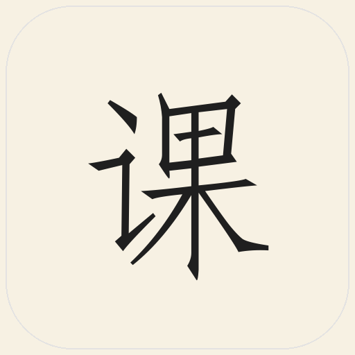

<div align="center">



# 课程表

**Material 3 课程表 · Android**

为黄山学院打造，也支持通过网页导入适配其他学校。

[](https://flutter.dev)
[](https://m3.material.io)
[](https://www.android.com)
[](LICENSE)
[](https://github.com/chengxixian/course-table/releases/latest)

**一次同步，整学期课表；一次导入，全部课程进日历。**

</div>

---

## Material 3 设计

| 令牌 | 实现 |
|---|---|
| 主色 | `ColorScheme.fromSeed` + Android 12 动态取色 |
| 配色 | 跟随系统 / 湖蓝 / 松绿 / 鸢尾紫 / 琥珀橙 / 山茶粉 / 青瓷 |
| 字体 | 中文仿宋（GB2312）+ 英文 Times New Roman；像素字体可选 |
| 图标 | Flutter Material Icons；像素图标可选 |
| 形状 | 按钮全圆角、卡片 medium、底部面板 large |
| 动效 | 页面淡入滑动、列表 stagger、按压缩放、形状加载 |
| 组件 | `flutoryx` 空状态、`m3e_core` 形状加载、Material 3 Expressive |

## 功能

| | |
|---|---|
| **教务同步** | 信息门户 SSO 登录，自动抓取课程、教师、教室、周次、调课与冲突 |
| **网页导入** | 应用内 WebView 登录并操作到课表页，读取整页 HTML 导入；保存地址/Cookie 供刷新 |
| **全部课程日历** | Android 直接写入 Google 日历（CalendarContract），一次导入整学期，也可导出 `.ics` |
| **小组件** | 4×3 今日课程（Google 日历风格）+ 2×1 下一节（时间/课程/教室/老师） |
| **时间显示** | 每节课显示 `08:00–08:45`，课间间隔可见 |
| **自动更新** | 读取 GitHub `version.json`，官方源不可用时切换镜像提示 |
| **隐私** | 账号 AES-GCM 加密存储于应用私有目录；无追踪、无上传 |

## 下载

[**前往 Releases 下载最新 APK**](https://github.com/chengxixian/course-table/releases/latest)

- Android 8.0+

## 构建

```bash
flutter pub get
flutter build apk --release
```

技术栈：Flutter 3.47 · Dart 3.13 · Material 3 · `dynamic_color` · `home_widget` · `workmanager` · `webview_flutter` · `m3e_core` · `flutoryx`

## 目录

```
lib/
  ui/              Material 3 页面与动效
  generic_html_parser.dart   通用网页课表解析
  imported_schedule_service.dart  网页课表刷新
  update_service.dart         GitHub 自动更新
  sync_service.dart           教务同步 + 小组件
android/           原生小组件、日历写入、WebView
assets/            字体、图标、赞赏码
```

## 隐私

- 不收集、不上传课表、账号或使用数据。
- 登录凭据只保存在本机应用私有目录，AES-GCM 加密。
- 网页导入保存页面地址和 Cookie，不记录密码；登录过期需重新导入。
- 本仓库不包含任何学生学号、姓名或考试信息。

## 致谢

感谢 **茨畔耕夫**、**润泽江海** 对项目的帮助与支持。

也感谢 Flutter、Material 3、`dynamic_color`、`home_widget`、`webview_flutter`、`m3e_core`、`flutoryx` 及所有开源作者。

## 许可

源代码以 [GNU General Public License v3.0](LICENSE) 发布，Copyright (C) 2026 chengxixian。

`assets/donate_wechat.png` 与 `assets/donate_alipay.jpg` 为作者个人赞赏码，属于个人标识，不随 GPL-3.0 源代码许可授权；未经许可不得替换、遮挡或复用。详见 [docs/DONATE.md](docs/DONATE.md)。

> 非官方个人工具，与黄山学院无隶属关系。
