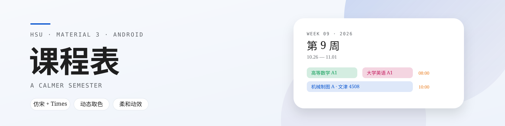
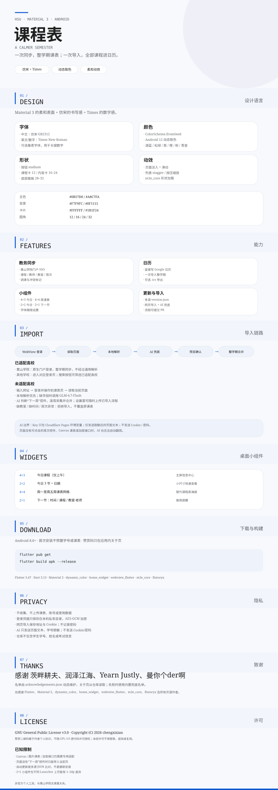

<picture>
  <source media="(prefers-color-scheme: dark)" srcset="docs/assets/readme/m3/banner-dark.svg">
  
</picture>

[下载 APK](https://github.com/chengxixian/course-table/releases/latest) · [更新记录](https://github.com/chengxixian/course-table/releases) · [问题反馈](https://github.com/chengxixian/course-table/issues) · [许可](LICENSE) · [致谢名单](acknowledgements.json)

<picture>
  <source media="(max-width: 700px) and (prefers-color-scheme: dark)" srcset="docs/assets/readme/m3/board-mobile-dark.svg">
  <source media="(max-width: 700px)" srcset="docs/assets/readme/m3/board-mobile-light.svg">
  <source media="(prefers-color-scheme: dark)" srcset="docs/assets/readme/m3/board-dark.svg">
  
</picture>
