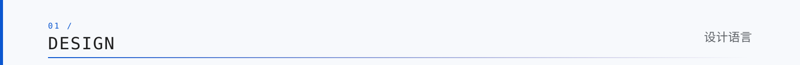
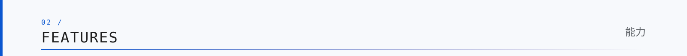
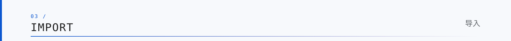
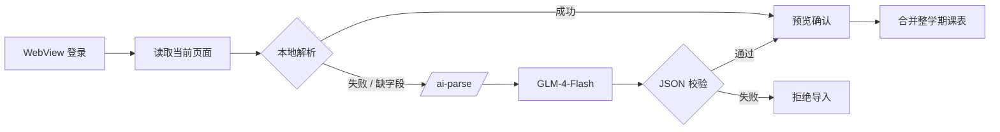
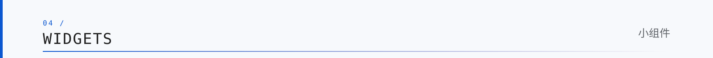
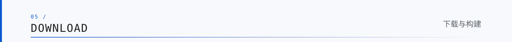
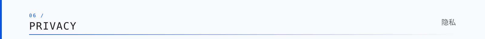
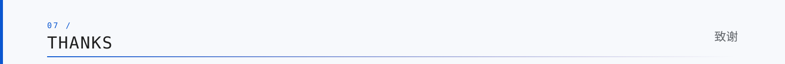
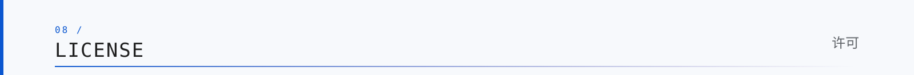

<div align="center">

<picture>
  <source media="(prefers-color-scheme: dark)" srcset="docs/assets/readme/m3/banner-dark.svg">
  
</picture>


# 课程表

**Material 3 课程表 · Android**

为黄山学院打造，也为其他学校保留网页导入与 AI 兜底。

[](https://flutter.dev)
[](https://m3.material.io)
[](https://www.android.com)
[](https://bigmodel.cn)
[](LICENSE)
[](https://github.com/chengxixian/course-table/releases/latest)

**一次同步，整学期课表；一次导入，全部课程进日历。**

[下载 APK](https://github.com/chengxixian/course-table/releases/latest) · [更新记录](https://github.com/chengxixian/course-table/releases) · [问题反馈](https://github.com/chengxixian/course-table/issues)

</div>

---

## 目录

| | | |
|---|---|---|
| [设计语言](#设计语言) | [能力](#能力) | [导入](#导入) |
| [小组件](#小组件) | [下载与构建](#下载与构建) | [隐私](#隐私) |
| [已知限制](#已知限制) | [致谢](#致谢) | [许可](#许可) |

---

<picture>
  <source media="(prefers-color-scheme: dark)" srcset="docs/assets/readme/m3/section-design-dark.svg">
  
</picture>

## 设计语言

> 和 App 一样：**Material 3 的柔和表面 + 仿宋的书写感 + Times 的数字感**，而不是另一套海报风格。

<table>
<tr>
<td width="50%" valign="top">

### 字体

- 中文：仿宋 GB2312
- 英文/数字：Times New Roman
- 可选：像素字体，仅用于品牌字和关键数字
- 小组件同步字体设置

</td>
<td width="50%" valign="top">

### 颜色

- `ColorScheme.fromSeed`
- Android 12 动态取色
- 湖蓝 / 松绿 / 鸢尾紫 / 琥珀橙 / 山茶粉 / 青瓷
- 浅色与深色都使用同一套语义色

</td>
</tr>
<tr>
<td width="50%" valign="top">

### 形状

- 按钮：stadium
- 课程卡：12
- 内容卡：16–24
- 底部面板：28–32
- 不使用硬边和重投影

</td>
<td width="50%" valign="top">

### 动效

- 页面淡入 + 滑动
- 列表 stagger
- 按压缩放
- `m3e_core` 形状加载
- 课程详情从课程卡矩形展开

</td>
</tr>
</table>

| 令牌 | 值 |
|---|---|
| 主色 | `#0B57D0`（浅色）/ `#A8C7FA`（深色） |
| 背景 | `#F7F9FC` / `#0F1115` |
| 卡片 | `#FFFFFF` / `#1B1F24` |
| 圆角 | 12 / 16 / 24 / 32 |
| 间距 | 4 / 8 / 12 / 16 / 20 / 24 |

---

<picture>
  <source media="(prefers-color-scheme: dark)" srcset="docs/assets/readme/m3/section-features-dark.svg">
  
</picture>

## 能力

<table>
<tr>
<td width="50%" valign="top">

### 教务同步

- 黄山学院信息门户 SSO
- 课程 / 教师 / 教室 / 周次
- 调课、冲突标记
- 原生整学期抓取

</td>
<td width="50%" valign="top">

### 日历

- Android 直接写 Google 日历
- 一次导入整学期
- 也可导出 `.ics`
- 重复导入自动跳过

</td>
</tr>
<tr>
<td width="50%" valign="top">

### 桌面小组件

- 4×3 今日课程（仅上午）
- 2×2 今日课程
- 4×4 周课表
- 2×1 下一节（大字）

</td>
<td width="50%" valign="top">

### 自动更新

- `version.json` 版本比对
- jsDelivr / Fastly / Gcore / Raw 多源
- 官方源不可用时切镜像
- 下载失败再切 `ghproxy`

</td>
</tr>
</table>

---

<picture>
  <source media="(prefers-color-scheme: dark)" srcset="docs/assets/readme/m3/section-import-dark.svg">
  
</picture>

## 导入



### 已适配高校

- 黄山学院：点击进入原生门户登录，走原来的教务同步，不经过通用解析
- 其他已收录学校：进入对应登录页，登录后导入
- 设置页可按高校名搜索

### 未适配高校

1. 输入学校课表网页完整地址
2. 在应用内登录并操作到课表页
3. 点「读取当前页面并导入」
4. 本地解析优先；缺字段时 AI 兜底
5. AI 自动判断「下一周」控件，逐周采集并合并
6. 预览确认后写入课表

### AI 边界

- 服务端固定模型：**GLM-4-Flash**
- Key 只在 Cloudflare Pages 环境变量，不进 APK
- 只发送页面文本；发送前脱敏学号，不发送 Cookie/密码
- 缺教室、缺时间、周次异常的结果直接拒绝，不覆盖原课表
- 页面没有可点击的周次控件、Canvas 图片或加密接口时，AI 也无法自动翻周

---

<picture>
  <source media="(prefers-color-scheme: dark)" srcset="docs/assets/readme/m3/section-widgets-dark.svg">
  
</picture>

## 小组件

| 尺寸 | 内容 | 适合 |
|---|---|---|
| **4×3** | 今日课程（仅上午） | 主屏信息中心 |
| **2×2** | 今日 3 节 + 日期 | 小尺寸快速查看 |
| **4×4** | 周一至周五周课表网格 | 替代课程表海报 |
| **2×1** | 下一节：时间 / 课程 / 教室·老师 | 极简提醒 |

所有小组件读取同一份 `schedule_widget` 数据；字体随设置切换，深色模式使用 `layout-night`。

> 已放置的旧小组件不会自动改变网格跨度；调整尺寸后请删除旧实例再重新添加。

---

<picture>
  <source media="(prefers-color-scheme: dark)" srcset="docs/assets/readme/m3/section-download-dark.svg">
  
</picture>

## 下载与构建

### 下载

[**前往 Releases 下载最新 APK**](https://github.com/chengxixian/course-table/releases/latest)

- Android 8.0+
- 首次安装不预置任何学号或课表
- 赞赏二维码只在应用内「关于」页出现，不在 README 展示

### 构建

```bash
flutter pub get
flutter build apk --release
```

技术栈：

`Flutter 3.47` · `Dart 3.13` · `Material 3` · `dynamic_color` · `home_widget` · `workmanager` · `webview_flutter` · `m3e_core` · `flutoryx`

<details>
<summary><b>项目结构</b></summary>

```text
lib/
  ui/                         Material 3 页面与动效
  generic_html_parser.dart    通用网页课表解析
  ai_import_service.dart      AI 解析兜底
  ai_nav_service.dart         AI 周次导航
  imported_schedule_service.dart
  update_service.dart         多源自动更新
  sync_service.dart           教务同步 + 小组件
android/                      原生小组件、日历写入、WebView
cloudflare/flow-pages/        Pages 中转（流程上传 / AI）
assets/                       字体、图标、赞赏码
```

</details>

---

<picture>
  <source media="(prefers-color-scheme: dark)" srcset="docs/assets/readme/m3/section-privacy-dark.svg">
  
</picture>

## 隐私

- 不收集、不上传课表、账号或使用数据
- 登录凭据只保存在本机应用私有目录，AES-GCM 加密
- 网页导入保存页面地址与 Cookie，用于刷新；不记录密码
- AI 解析只发送页面文本，学号会脱敏；不发送 Cookie/密码
- 本仓库不包含任何学生学号、姓名或考试信息

---

<picture>
  <source media="(prefers-color-scheme: dark)" srcset="docs/assets/readme/m3/section-thanks-dark.svg">
  
</picture>

## 致谢

感谢 **茨畔耕夫**、**润泽江海**、**Yearn Justly**、**曼你个der啊** 对项目的帮助与支持。

名单由 [`acknowledgements.json`](acknowledgements.json) 动态维护，应用内「关于」页从仓库读取；读取失败时使用内置兜底名单。

也感谢 Flutter、Material 3、`dynamic_color`、`home_widget`、`webview_flutter`、`m3e_core`、`flutoryx` 及所有开源作者。

---

<picture>
  <source media="(prefers-color-scheme: dark)" srcset="docs/assets/readme/m3/section-license-dark.svg">
  
</picture>

## 许可

源代码以 [GNU General Public License v3.0](LICENSE) 发布，Copyright (C) 2026 chengxixian。

`assets/donate_wechat.png` 与 `assets/donate_alipay.jpg` 为作者个人赞赏码，属于个人标识，不随 GPL-3.0 源代码许可授权；未经许可不得替换、遮挡或复用。详见 [docs/DONATE.md](docs/DONATE.md)。

---

## 已知限制

- 未适配学校的网页结构差异很大；AI 只能处理「页面文本 + 可点击控件」，遇到 Canvas、图片课表或后端加密接口仍需要专用适配。
- 全学期导入依赖页面能切换周次；如果学校只显示当前周且没有「下一周」控件，只能导入当前页。
- 自动更新是多源 JSON 比对，不是应用内静默安装。
- 2×1 小组件在不同 Launcher 上可能有 1–2dp 的留白差异。

> 非官方个人工具，与黄山学院无隶属关系。
